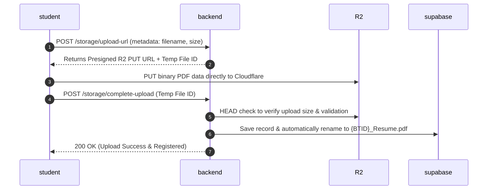
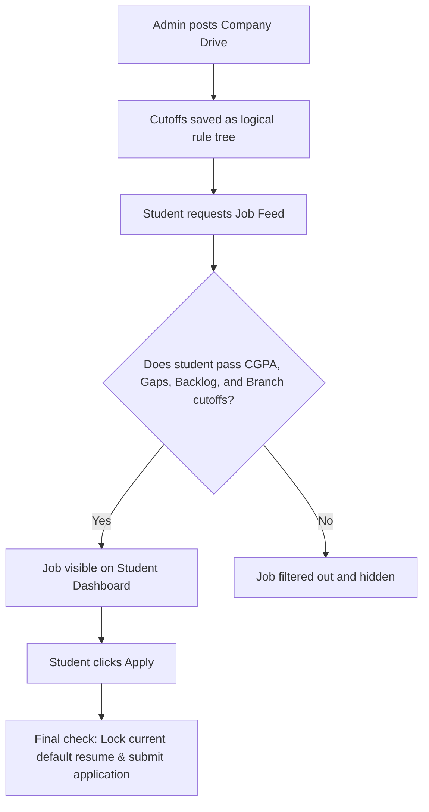

# PlacedThere — IIIT Nagpur Placement Platform Backend

Welcome to the backend repository of **PlacedThere**, the unified placement and internship application portal designed for IIIT Nagpur. This system bridges the gap between students, Training & Placement (T&P) Cell administrators, and recruiters, automating cutoffs, resume handling, application queues, and deadline tracking.

---

## 👥 Meet the Team
This platform is built and maintained by:
*   **Soham Pawar** — THE MENTOR and GOD
*   **Akash** — Python Backend Architecture & APIs
*   **Wrichik Paul** — Supabase Database Architecture & SQL Schema
*   **Harsh Jaiswal** — Cloudflare R2 File Handling & Storage Pipeline
*   **Junaid & Pushkar** — Flutter Mobile App Developers
*   **Harshit Soni** — UI/UX & Figma Design

---

## 🛠️ The Tech Stack
*   **Framework:** FastAPI (Python 3.14) for fast, asynchronous, and self-documenting REST APIs.
*   **Database:** Supabase (PostgreSQL) for relational data, triggers, and real-time operations.
*   **File Storage:** Cloudflare R2 (S3 API) for secure, private PDF uploads (resumes & cover letters).
*   **Authentication:** Google OAuth verified backend-side via Supabase JWT verification.
*   **Notifications:** Asynchronous SMTP Email workers and matching In-App Notification feeds.

---

## 🔄 Core Workflows & Logic

### 1. The Resume Upload Handshake
To prevent our server from being choked by large PDF uploads, we use a **dual-phase presigned upload pipeline** to Cloudflare R2:



### 2. The Dynamic Eligibility Engine
When an admin posts a drive, cutoffs (CGPA, active backlogs, education gaps, branch, and custom fields) are compiled into a logical rule tree.



---

## 📂 Codebase Directory Structure

```
tnp/
├── app/
│   ├── main.py                 # App entry point, CORS settings, and router setup
│   ├── admin/
│   │   └── router.py           # Drive creation, CSV templates, applicant listings & exports
│   ├── auth/
│   │   └── dependencies.py     # Supabase Google OAuth verification & BTID derivation
│   ├── resumes/
│   │   └── router.py           # Soft-delete (retention for active jobs) vs Hard-delete logic
│   ├── storage/
│   │   ├── router.py           # Upload URLs, complete uploads, and resume renamers
│   │   ├── service.py          # Upload handshakes and R2 lifecycle orchestrations
│   │   ├── repository.py       # Supabase CRUD operations for files
│   │   └── r2_client.py        # Cloudflare R2 wrapper (Boto3 connection)
│   ├── students/
│   │   └── router.py           # Profile viewing, phone updates, notifications, and job feed
│   ├── applications/
│   │   └── router.py           # Application submissions and resume locking
│   └── services/
│       ├── eligibility_engine.py  # Evaluates student profiles against drive criteria
│       └── email_service.py       # Asynchronous SMTP notifications dispatcher
├── tests/
│   └── (118 Mock & Integration Tests)
```

---

## ⚡ Setup & Installation

### 1. Setup Virtual Environment
Run the following commands in the `tnp/` directory:
```bash
# Create and activate python environment
python -m venv .venv
.venv\Scripts\activate      # Windows
source .venv/bin/activate  # macOS/Linux

# Install required libraries
pip install -r requirements.txt
```

### 2. Configure Credentials
Copy the template and fill in your keys:
```bash
cp .env.example .env
```
Fill in the values in your `.env`:
*   `SUPABASE_URL` & `SUPABASE_KEY`
*   `R2_ACCOUNT_ID`, `R2_ACCESS_KEY_ID`, `R2_SECRET_ACCESS_KEY`, and `R2_BUCKET_NAME`
*   `SMTP_HOST`, `SMTP_PORT`, `SMTP_USER`, and `SMTP_PASSWORD`

### 3. Start the Server
To start the FastAPI hot-reloading development server:
```bash
uvicorn app.main:app --reload
```
Once running, you can open the interactive API docs at `http://127.0.0.1:8000/docs`.

### 4. Run the Tests
To run all 118 unit and integration tests:
```bash
pytest
```

---

## 📥 Flutter Integration Cheat Sheet

### 1. Authentication Header
For every endpoint requiring authentication, pass the Supabase JWT token:
```
Authorization: Bearer <SUPABASE_JWT_TOKEN>
```

### 2. Student APIs
*   `GET /api/students/profile`: Get verified academic details.
*   `PATCH /api/students/profile`: Update contact info (`{"phone_number": "+91 ..."}`).
*   `GET /api/students/jobs`: Get open eligible job listings.
*   `POST /api/applications/apply`: Apply to a drive (`{"job_id": "UUID", "resume_file_id": "UUID"}`).
*   `GET /api/students/notifications`: Get notification logs.
*   `PATCH /api/students/notifications/{id}/read`: Mark notification as read.

### 3. Resume APIs
*   `GET /storage/files`: List uploaded files.
*   `POST /storage/upload-url`: Request upload URL (`{"filename": "cv.pdf", "mime_type": "application/pdf", "size_bytes": 1024}`).
*   `POST /storage/complete-upload`: Confirm R2 upload (`{"file_id": "temp_id"}`).
*   `POST /storage/files/{file_id}/default`: Set a resume as primary.
*   `POST /storage/files/{file_id}/rename-to-btid`: Rename a resume to `{BTID}_Resume.pdf`.
*   `DELETE /storage/files/{file_id}`: Remove resume (automatically soft-deletes if already submitted to a job).
